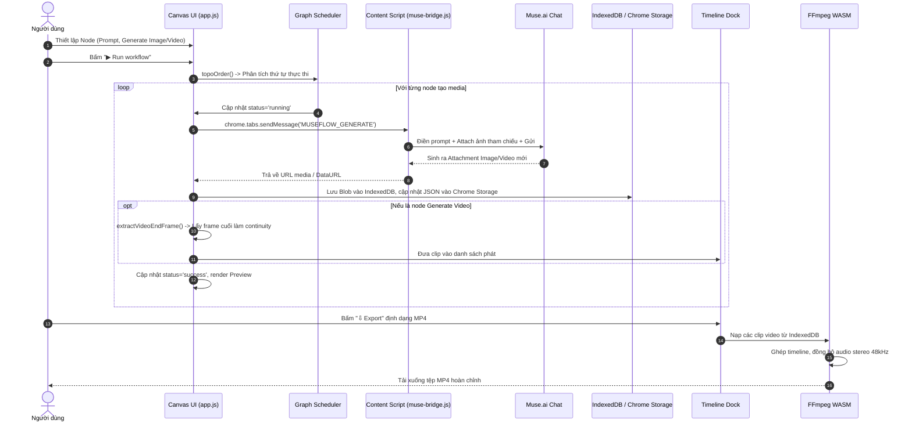

# Kiến trúc Tổng thể Dự án MuseFlow

## 1. Mô hình kiến trúc cấp cao (High-Level Architecture)
MuseFlow được xây dựng theo mô hình **Local-First, Event-Driven, Client-Side Pipeline**:
- Toàn bộ trạng thái và dữ liệu nhị phân đều nằm tại trình duyệt của người dùng.
- Ứng dụng không giao tiếp với bất kỳ backend trung gian nào; tương tác sinh nội dung được thực hiện qua cơ chế **DOM Automation Bridge** vào tab Muse.ai đang mở trong cùng profile trình duyệt.

```mermaid
flowchart TB
    subgraph Browser["Trình duyệt Chromium (Client Browser)"]
        subgraph ExtHost["MuseFlow Extension Context (Manifest V3)"]
            BG["Service Worker<br/>(background.js)"]
            AppUI["Canvas & Timeline UI<br/>(app.html + app.js)"]
            
            subgraph StorageSubsystem["Hệ thống lưu trữ lai (Hybrid Storage)"]
                CStorage[("Chrome Local Storage<br/>(Graph Topology & Settings)")]
                IDB[("IndexedDB: 'museflow-media'<br/>(Blobs: Images/Videos/EndFrames)")]
            end
            
            FFmpegWasm["Bộ giải mã FFmpeg WebAssembly<br/>(vendor/ffmpeg/)"]
        end

        subgraph MuseContext["Trang Muse.ai (https://muse.ai/*)"]
            Bridge["Page Bridge Script<br/>(muse-bridge.js)"]
            MuseDOM["Giao diện Muse Chat Composer & DOM"]
        end
    end

    BG -->|"Khởi tạo / Focus Tab"| AppUI
    AppUI -->|"chrome.tabs.sendMessage<br/>(MUSEFLOW_GENERATE, CHECK_SESSION)"| Bridge
    Bridge -->|"DOM Manipulation: Paste prompt, Attach images"| MuseDOM
    MuseDOM -->|"MutationObserver bắt Media Attachment mới"| Bridge
    Bridge -->>|"Trả về Media URL / DataURL"| AppUI

    AppUI <-->|"Đọc/Ghi trạng thái đồ thị JSON"| CStorage
    AppUI <-->|"Dehydrate / Hydrate Media Blob"| IDB
    AppUI -->|"Truyền danh sách clip, render audio silence, nạp vào"| FFmpegWasm
    FFmpegWasm -->>|"Xuất tệp MP4 H.264/AAC"| AppUI
```

---

## 2. Các tầng thành phần (Layered Architecture)

### Tầng 1: Tầng Giao diện & Tương tác Canvas (Presentation & Canvas Layer)
- **Tập tin:** `app.html`, `styles.css`, `app.js` (Canvas module).
- **Trách nhiệm:**
  - Quản lý không gian canvas vô hạn 2D: hỗ trợ thao tác kéo trượt (pan), thu phóng (zoom từ 25% đến 250%), và căn vừa màn hình (fit).
  - Lựa chọn đối tượng: chọn đơn, chọn nhiều qua phím Shift/Ctrl, kéo khung chữ nhật (marquee selection).
  - Hệ thống đồ họa dây nối: Lớp SVG `#edges` vẽ đường cong Bezier bậc ba mượt mà giữa các cổng vào/ra, được lập lịch vẽ lại tối ưu qua `requestAnimationFrame`.
  - Phân vùng nhóm (Group Regions) và thẻ ghi chú tự do (Text Notes).

### Tầng 2: Tầng Lập lịch & Quản lý Đồ thị (Graph & Scheduler Layer)
- **Tập tin:** `app.js` (Graph Engine module).
- **Trách nhiệm:**
  - Mô hình hóa quy trình làm việc dưới dạng đồ thị có hướng không chu trình (**DAG - Directed Acyclic Graph**).
  - Thuật toán **Kahn’s Algorithm (`topoOrder`)**: Phân tích thứ tự phụ thuộc giữa các node để lên lịch thực thi tuần tự chuẩn xác.
  - Thuật toán **BFS Cycle Detection (`wouldCreateCycle`)**: Ngăn chặn người dùng tạo kết nối tạo vòng lặp vô tận.
  - Bộ giải quyết chuỗi đa nguồn: Đệ quy thu thập prompt (`resolvePrompt`, `resolveText`) và ảnh tham chiếu (`resolveReferences`).

### Tầng 3: Tầng Cầu nối Tự động hóa (DOM Automation Bridge Layer)
- **Tập tin:** `muse-bridge.js`.
- **Trách nhiệm:**
  - Hoạt động độc lập trong ngữ cảnh bảo mật của trang web `https://muse.ai/*`.
  - Tự động điền dữ liệu vào textarea thông qua descriptor prototype setter để kích hoạt cơ chế nhận diện state của React.
  - Sử dụng API `DataTransfer` để giả lập thao tác tải lên nhiều ảnh tham chiếu vào thẻ `input[type="file"]`.
  - Giám sát DOM bằng `MutationObserver`, bắt các trường hợp Muse từ chối nội dung (`SCENE_REFUSED`) hoặc tài khoản hết credit.

### Tầng 4: Tầng Lưu trữ Bất đối xứng (Hybrid Storage Layer)
- **Tập tin:** `app.js` (Storage module).
- **Trách nhiệm:**
  - Khắc phục giới hạn dung lượng lưu trữ 10MB của `chrome.storage.local`.
  - **Dehydration:** Tách các chuỗi base64 và Blob media nặng ra khỏi đối tượng JSON của node, lưu vào Object Store `assets` của `IndexedDB` (`museflow-media`), chỉ giữ lại chuỗi tham chiếu nhẹ `museflow-idb:{key}` trong Chrome Storage.
  - **Hydration:** Khi tải lại canvas, tự động đọc Blob từ IndexedDB và sinh `blob:` URL để gán vào các thẻ `` và `<video>`.

### Tầng 5: Tầng Dựng và Xuất Video (Timeline & Video Assembly Layer)
- **Tập tin:** `app.js` (Timeline module), `vendor/ffmpeg/`.
- **Trách nhiệm:**
  - Quản lý danh sách clip tuần tự trên dock Timeline, điều chỉnh thời lượng từng phân cảnh.
  - Cơ chế xem trước kép (**Seamless Dual-Player Buffering**): Sử dụng 2 video player xoay vòng để loại bỏ hiện tượng nhấp nháy/gián đoạn giữa các phân cảnh.
  - Dựng MP4 cục bộ qua **FFmpeg WASM**: Ghép nối trực tiếp (copy-mode nếu đồng nhất codec) hoặc dùng bộ lọc `filter_complex` để căn chỉnh tỷ lệ khung hình và chèn dải âm thanh khoảng lặng (silent audio).

---

## 3. Luồng dữ liệu tổng thể (End-to-End Data Flow)



---

## Liên kết liên quan
- [Giới thiệu](gioi-thieu.md)
- [Cấu trúc thư mục](cau-truc-thu-muc.md)
- [Chi tiết Module Đồ thị](../03-module/graph-engine.md)
- [Chi tiết Cầu nối Muse](../03-module/muse-bridge.md)
- [Chi tiết Hệ thống Lưu trữ](../03-module/storage-system.md)
