# Module Graph Engine (Đồ thị Node & Bộ Lập lịch Thực thi)

## 1. Mục đích và Phạm vi
Module **Graph Engine** là bộ não tính toán của MuseFlow, chịu trách nhiệm mô hình hóa luồng dữ liệu workflow dưới dạng Đồ thị Có hướng Không Chu trình (**DAG - Directed Acyclic Graph**), kiểm soát tính tương thích giữa các cổng, ngăn chặn vòng lặp, tính toán thứ tự thực thi topo và vẽ các đường nối SVG Bezier.

---

## 2. Định nghĩa các Node và Cổng (Node Definitions)
Hệ thống hỗ trợ 10 loại node được khai báo cấu trúc trong đối tượng `nodeDefs`:

| Loại Node | Tiêu đề | Cổng vào (Inputs) | Cổng ra (Outputs) | Mục đích sử dụng |
| :--- | :--- | :--- | :--- | :--- |
| `prompt` | Prompt | *(Không)* | `text` (type: text) | Nhập mô tả câu chuyện hoặc yêu cầu sinh ảnh/video |
| `negativePrompt` | Negative Prompt | *(Không)* | `text` (type: negative) | Khai báo các chi tiết cần tránh (watermark, xấu, thừa ngón...) |
| `textAppend` | Text Append | `text` (type: text) | `text` (type: text) | Nối thêm đoạn văn bản bổ trợ vào sau prompt nhận được |
| `textConcat` | Text Merge | `text` (multi-input) | `text` (type: text) | Ghép nhiều nguồn văn bản theo dấu phân cách tùy chọn (mặc định `, `) |
| `imageInput` | Image Input | *(Không)* | `image` (type: image) | Chọn tệp ảnh cục bộ từ máy tính người dùng |
| `references` | References | `reference1`..`reference8` | `image` (type: image) | Gom tối đa 8 ảnh tham chiếu để gửi đồng loạt cho các node sinh |
| `generateImage` | Generate Image | `prompt`, `negative`, `reference` | `image` (type: image) | Gửi lệnh sinh 1 bức ảnh tĩnh tới Muse.ai |
| `generateVideo` | Generate Video | `prompt`, `negative`, `reference` | `video` (type: video)<br/>`endFrame` (type: image) | Gửi lệnh sinh clip video và trích xuất khung hình cuối cùng |
| `imageResize` | Image Resize | `image` (type: image) | `image` (type: image) | Đổi kích thước ảnh cục bộ theo thuật toán cover/contain/stretch |
| `preview` | Preview | `media` (accepts image/video) | *(Không)* | Hiển thị phóng to kết quả ảnh hoặc video tạo được |
| `timeline` | Timeline | `clip1`..`clip6` | *(Không)* | Node hiển thị danh sách clip trên canvas (kết nối với dock) |

---

## 3. Quy tắc Tương thích Cổng (Port Compatibility)
Hàm `canConnectTypes(outputType, inputType)` kiểm tra tính hợp lệ khi nối dây:
- Cổng `text` chỉ nối vào cổng nhận `text`.
- Cổng `negative` chỉ nối vào cổng nhận `negative`.
- Cổng `image` nối vào cổng nhận `image` hoặc `media`.
- Cổng `video` nối vào cổng nhận `video` hoặc `media`.
- Cổng đặc biệt `endFrame` trên node `generateVideo` có kiểu `image`, cho phép nối trực tiếp sang cổng `reference` của node video tiếp theo để duy trì tính liên tục (Continuity).

---

## 4. Thuật toán Phát hiện Chu trình (Cycle Detection Algorithm)
Để ngăn chặn lỗi người dùng nối dây vòng quanh tạo thành một vòng lặp vô tận (ví dụ: Node A $\rightarrow$ Node B $\rightarrow$ Node C $\rightarrow$ Node A), hàm `wouldCreateCycle(sourceId, targetId, replacedPort)` thực hiện duyệt đồ thị theo chiều rộng (BFS):

```javascript
function wouldCreateCycle(sourceId, targetId, replacedPort) {
  const pending = [targetId], seen = new Set();
  while (pending.length) {
    const id = pending.pop();
    // Nếu từ target theo các cạnh xuôi mà đi tới được sourceId -> tạo thành vòng lặp kín
    if (id === sourceId) return true;
    if (seen.has(id)) continue;
    seen.add(id);
    for (const edge of state.edges) {
      if (edge.source === id && !(edge.target === targetId && edge.targetPort === replacedPort)) {
        pending.push(edge.target);
      }
    }
  }
  return false;
}
```

---

## 5. Thuật toán Sắp xếp Topo (Topological Sort - Kahn's Algorithm)
Trước khi thực thi workflow, toàn bộ các node phải được sắp xếp thành một mảng tuần tự sao cho mọi node tiền đề (nguồn) luôn đứng trước node tiêu thụ kết quả (đích). Hàm `topoOrder()` triển khai thuật toán **Kahn**:

```mermaid
flowchart LR
    Prompt["Node Prompt<br/>(in-degree = 0)"] -->|"text"| Gen["Node Generate Image<br/>(in-degree = 1)"]
    Ref["Node References<br/>(in-degree = 0)"] -->|"image"| Gen
    Gen -->|"image"| Prev["Node Preview<br/>(in-degree = 1)"]

    style Prompt fill:#8b6fff22,stroke:#8b6fff
    style Ref fill:#48a8ed22,stroke:#48a8ed
    style Gen fill:#6c47ff44,stroke:#6c47ff
    style Prev fill:#252834,stroke:#8064ff
```



1. **Khởi tạo:** Tính toán bán bậc vào (`in-degree`: số lượng kết nối đi vào) cho từng node trên canvas.
2. **Bổ sung phụ thuộc ngầm (Implicit Constraints):**
   - Ràng buộc continuity: Nếu node Video B bật `continuity: true` lấy frame từ Video A trên Timeline, một cạnh phụ thuộc ảo từ A $\rightarrow$ B được bổ sung.
   - Ràng buộc tùy chỉnh từ Modal thứ tự chạy: Bổ sung các cạnh phụ thuộc theo thứ tự kéo thả thủ công của người dùng.
3. **Duyệt hàng đợi:**
   - Đưa tất cả các node có `in-degree == 0` vào hàng đợi `q`.
   - Lấy từng node ra, đưa vào mảng kết quả `out`.
   - Với mỗi cạnh đi ra từ node đó đến node đích `target`, giảm `in-degree` của `target` đi 1.
   - Nếu `target` có `in-degree == 0`, đưa tiếp vào hàng đợi `q`.
4. **Kiểm tra hợp lệ:** Nếu số phần tử trong `out` khác tổng số node trên canvas, đồ thị bị chu trình lặp và hệ thống sẽ ném ra ngoại lệ `Workflow contains a cycle`.

---

## 6. Đồ họa Dây nối SVG (SVG Bezier Curves)
- Các đường nối được vẽ trên thẻ `<svg id="edges">`.
- Tọa độ cổng được tính bằng `getPortCenter(nodeId, portId, kind)`.
- Phương trình đường cong Bezier bậc ba:
  $$d = M\ a.x\ a.y\ C\ (a.x + dir \times bend)\ a.y,\ (b.x - dir \times bend)\ (b.y + fan),\ b.x\ b.y$$
  Trong đó:
  - `bend`: Độ uốn mềm mại tính theo khoảng cách trục hoành $\Delta x$.
  - `fan`: Độ xòe dọc để các dây nối không đè khít lên nhau khi nối vào cổng đa kết nối (multi-input).
  - Lớp `.edge-hit` trong suốt bao quanh với độ dày 22px để người dùng dễ dàng nhấp chuột phải mở menu xóa đường nối.

---

## Liên kết liên quan
- [Module Canvas Core](canvas-core.md)
- [Module Timeline Engine](timeline-engine.md)
- [Chi tiết Luồng thực thi](../05-luong-xu-ly/thuc-thi-workflow-sinh-media.md)
