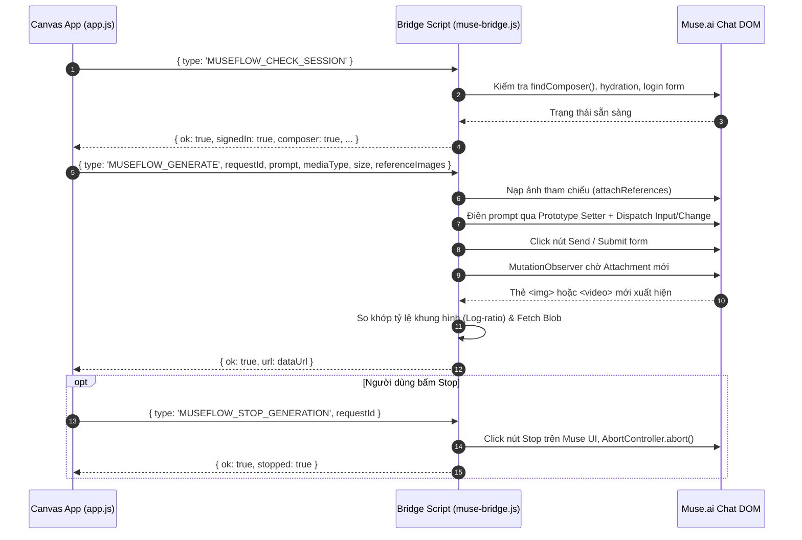

# Module Muse Bridge (Cầu nối Tự động hóa Giao diện Muse.ai)

## 1. Mục đích và Phạm vi
Module **Muse Bridge** (triển khai trong [muse-bridge.js](file:///e:/Project/museflow/muse-bridge.js)) là một Content Script chạy trực tiếp trong không gian bảo mật của trang web `https://muse.ai/*`. Module này đóng vai trò như một người dùng ảo tự động thực hiện các thao tác: kiểm tra phiên làm việc, nạp prompt, đính kèm ảnh tham chiếu, gửi lệnh, theo dõi phản hồi, bắt lỗi từ chối và hủy tác vụ.

---

## 2. Kiến trúc Giao tiếp Tin nhắn (Messaging Protocol)
Bridge lắng nghe các yêu cầu từ Canvas App gửi qua `chrome.tabs.sendMessage`:



---

## 3. Các kỹ thuật Tự động hóa DOM Đặc biệt

### a. Vượt qua cơ chế Virtual DOM của React (Prototype Setter)
Nếu chỉ gán `textarea.value = text`, React sẽ không nhận biết được sự thay đổi vì React theo dõi state nội bộ qua synthetic events. Bridge sử dụng thuộc tính descriptor gốc của trình duyệt:
```javascript
const setter = Object.getOwnPropertyDescriptor(HTMLTextAreaElement.prototype, 'value')?.set;
setter.call(composer, String(prompt));
composer.dispatchEvent(new Event('input', { bubbles: true }));
composer.dispatchEvent(new Event('change', { bubbles: true }));
```

### b. Giả lập tải lên nhiều ảnh tham chiếu qua `DataTransfer`
Để đính kèm ảnh tham chiếu từ URL (hoặc Blob) vào ô chat mà không cần mở hộp thoại chọn tệp của hệ điều hành:
1. `fetch()` ảnh về dưới dạng nhị phân `Blob`.
2. Tạo đối tượng `File` với tên định dạng chuẩn (`museflow-reference-01.png`).
3. Sử dụng `DataTransfer API` để đóng gói mảng tệp:
   ```javascript
   const transfer = new DataTransfer();
   batch.forEach(file => transfer.items.add(file));
   const setter = Object.getOwnPropertyDescriptor(HTMLInputElement.prototype, 'files')?.set;
   setter.call(input, transfer.files);
   input.dispatchEvent(new Event('input', { bubbles: true, composed: true }));
   input.dispatchEvent(new Event('change', { bubbles: true, composed: true }));
   ```
4. Chờ giao diện hiển thị ảnh preview thumbnail trước khi gửi prompt.

### c. Bắt Attachment mới bằng `MutationObserver`
Thay vì thăm dò liên tục bằng `setInterval`, Bridge sử dụng `MutationObserver` theo dõi toàn bộ cây tài liệu:
- Lọc các attachment mới không nằm trong tập `baseline` (đã có trước khi gửi lệnh).
- Bắt sự kiện khi thuộc tính `src`, `poster`, `data-video-src` của thẻ `<video>` hoặc `` được cập nhật sau khi quá trình sinh kết thúc.

---

## 4. Thuật toán So khớp Tỷ lệ Khung hình (Log-Ratio Score)
Khi Muse.ai trả về media, có thể có nhiều thẻ ảnh/video hiển thị cùng lúc. Để chọn chính xác media vừa được tạo theo tỷ lệ người dùng yêu cầu:
$$\text{Score} = \left| \ln\left( \frac{\text{width} / \text{height}}{\text{expectedRatio}} \right) \right|$$
- Nếu sai số $\text{Score} \le 0.09$, media được coi là khớp hoàn hảo với tỷ lệ yêu cầu.
- Sắp xếp ưu tiên các media có sai số nhỏ nhất và nằm sau trong cây DOM (mới sinh).

---

## 5. Cơ chế Nhận diện Từ chối (Refusal & Safety Policy Detection)
Hàm `isRefusalContext(context)` quét toàn bộ các bong bóng phản hồi mới của Muse AI để nhận biết khi AI từ chối tạo nội dung:
- **Tiếng Anh:** Nhận diện các mẫu câu `sorry... cannot`, `violates policy`, `safety guidelines prevent`, `generation was blocked`.
- **Tiếng Việt:** Nhận diện các mẫu câu `không tạo được`, `chưa thể tạo`, `không thể tạo cảnh này`, `đề xuất phiên bản tương đương`.
- Khi phát hiện từ chối, Bridge ném mã lỗi đặc biệt:
  ```javascript
  const error = new Error(`Muse could not generate this scene: ${currentContext.slice(-700)}`);
  error.code = 'SCENE_REFUSED';
  throw error;
  ```
  Mã lỗi này cho phép [app.js](file:///e:/Project/museflow/app.js) tự động kích hoạt tiến trình thử lại một lần bằng prompt thay thế an toàn.

---

## Liên kết liên quan
- [Đặc tả Giao thức Tin nhắn (Message Protocol)](../06-api/message-protocol.md)
- [Luồng xử lý Từ chối và Thử lại](../05-luong-xu-ly/xu-ly-refusal-va-retry.md)
- [Chi tiết mã nguồn muse-bridge.js](../04-chi-tiet-ma-nguon/muse-bridge-js.md)
