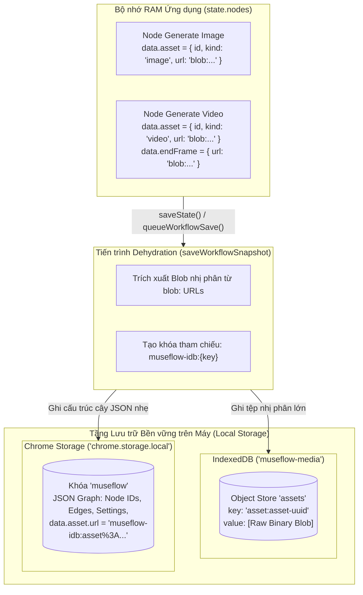

# Module Storage System (Hệ thống Lưu trữ Lai & Quản lý Trạng thái)

## 1. Mục đích và Phạm vi
Module **Storage System** giải quyết thách thức cốt lõi về lưu trữ trong môi trường tiện ích mở rộng: dung lượng của `chrome.storage.local` bị giới hạn ở mức khoảng 10MB, trong khi một workflow tạo video dài có thể chứa hàng chục megabyte tệp video MP4/WebM và ảnh chất lượng cao. MuseFlow sử dụng mô hình **Lưu trữ Lai (Hybrid Storage Architecture)** kết hợp Chrome Local Storage và IndexedDB.

---

## 2. Mô hình Kiến trúc Lưu trữ Lai (Hybrid Storage Architecture)

---

## 3. Quy trình Tách Dữ liệu (Dehydration Pipeline)
Khi tiến trình lưu được kích hoạt (`saveState()` hoặc `scheduleAutoSave()`):
1. Hàm `saveWorkflowSnapshot()` tạo một bản sao sâu (deep clone) của đối tượng `state`.
2. Hàm `dehydrateMediaUrl(url, key)` kiểm tra:
   - Nếu URL là `data:` (base64) hoặc `blob:`:
     - Gửi `fetch(url)` nội bộ để lấy dữ liệu dạng `Blob`.
     - Gọi `putMedia(key, blob)` để lưu Blob vào Object Store `assets` của IndexedDB.
     - Thay thế giá trị URL trong cây JSON bằng chuỗi định danh nhẹ: `museflow-idb:` + mã hóa URL của `key`.
3. Lưu toàn bộ cây JSON đồ thị đã "khử nước" vào `chrome.storage.local.set({ museflow: snapshot })`.
4. Hàng đợi lưu tuần tự (`workflowSaveQueue`) sử dụng cơ chế Promise chaining để ngăn chặn hiện tượng xung đột ghi đè dữ liệu (race conditions).

---

## 4. Quy trình Phục hồi Dữ liệu (Hydration Pipeline)
Khi mở lại ứng dụng hoặc tải lại tab (`loadState()`):
1. Tiện ích đọc cấu trúc đồ thị JSON từ `chrome.storage.local.get('museflow')`.
2. Hàm `hydrateWorkflowMedia()` duyệt qua từng node trong đồ thị:
   - Với mỗi thuộc tính media có URL bắt đầu bằng `museflow-idb:`:
     - Trích xuất khóa `key` lưu trữ.
     - Hàm `getMedia(key)` truy vấn IndexedDB để lấy lại đối tượng `Blob` nhị phân.
     - Gọi `URL.createObjectURL(blob)` để sinh một URL blob cục bộ mới có thể hiển thị trực tiếp trên các thẻ `` và `<video>`.
     - Sử dụng một bộ nhớ đệm `cache = new Map()` trong phiên để không sinh trùng lặp Object URL cho cùng một tài nguyên.
3. Cập nhật lại giao diện và vẽ lại đồ thị.

---

## 5. Nhập và Xuất Tệp Workflow Di động (.json)

### Xuất tệp (`exportWorkflowFile`)
- Cho phép người dùng tải xuống quy trình làm việc dưới dạng một tệp JSON duy nhất (`26MuseFlow-Workflow-<timestamp>.json`).
- Hàm `packageUrl()` tự động chuyển đổi tất cả các Blob trong IndexedDB thành chuỗi **Base64 Data URL** và nhúng trực tiếp vào tệp JSON.
- Nhờ vậy, tệp workflow có thể gửi sang máy tính khác hoặc chia sẻ cho người khác mở mà không bị mất ảnh và video đã tạo.

### Nhập tệp (`importWorkflowFile`)
- Đọc nội dung tệp JSON do người dùng chọn.
- Kiểm tra tính hợp lệ của cấu trúc `format: "26flow-workflow"`, danh sách `nodes` và `edges`.
- Tự động lưu bản snapshot trước khi ghi đè vào Undo Stack.
- Chuyển đổi các chuỗi base64 nhúng trong file thành Blob và lưu lại vào IndexedDB của máy tính mới.

---

## Liên kết liên quan
- [Module Canvas Core](canvas-core.md)
- [Module Timeline Engine](timeline-engine.md)
- [Luồng Đồng bộ IndexedDB](../05-luong-xu-ly/dong-bo-va-luu-tru-indexeddb.md)
