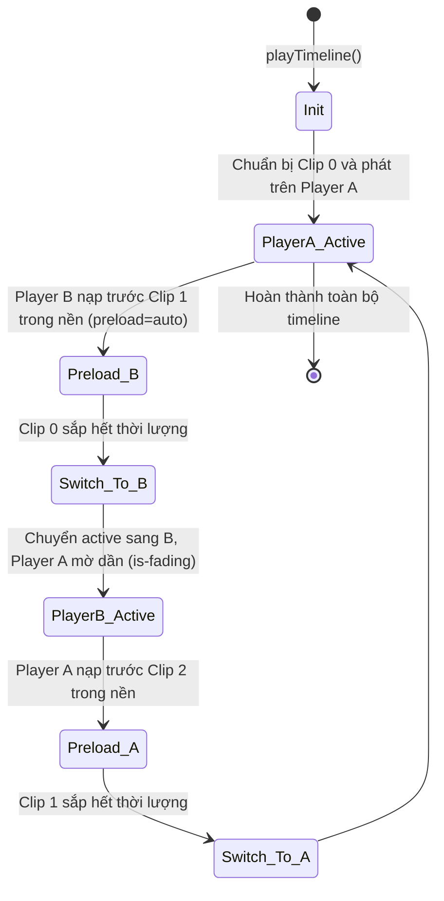

# Module Timeline Engine (Biên tập & Xuất Video Client-Side)

## 1. Mục đích và Phạm vi
Module **Timeline Engine** chịu trách nhiệm cung cấp bàn dựng video đa cảnh (Multi-scene Timeline Dock) ở chân màn hình, hỗ trợ sắp xếp thứ tự clip, tùy chỉnh thời lượng phát, phát xem trước không gián đoạn (seamless preview), và xuất video hoàn chỉnh định dạng MP4/WebM bằng engine **FFmpeg WebAssembly** xử lý 100% trên máy người dùng.

---

## 2. Giao diện Thanh Dock Timeline
- Nằm cố định ở chân màn hình, có thể thu gọn (`collapsed`) hoặc mở rộng bằng nút `▲/▼`.
- **Thước đo thời gian (Ruler & Playhead):** Hiển thị các vạch chia 5 giây một lần. Người dùng có thể kéo thả kim phát (playhead) hoặc click chuột lên thước đo để tua nhanh/chậm vị trí xem trước.
- **Các khối clip (Dock Clips):**
  - Hiển thị ảnh bìa (thumbnail) hoặc video xem trước thu nhỏ.
  - Tên phân cảnh và số thứ tự (`01 · Scene 1`).
  - Hộp nhập thời lượng phát tính theo giây (`Play (sec)`).
  - Hỗ trợ kéo thả (drag and drop) để sắp xếp lại thứ tự xuất hiện của các clip.

---

## 3. Cơ chế Xem trước Liền mạch (Seamless Dual-Player Buffering)
Khi phát chuỗi nhiều clip video khác nhau trong một thẻ `<video>` đơn lẻ, việc đổi thuộc tính `src` thường gây ra hiện tượng màn hình đen hoặc khựng hình (buffering flicker). MuseFlow giải quyết vấn đề này bằng kỹ thuật **Double Buffering** với 2 thẻ video xoay vòng (`timelinePlayer` và `timelinePlayerNext`):



- Hàm `playTimeline()` điều phối chuyển đổi luân phiên giữa hai player.
- Hàm `waitForFrame(video)` sử dụng `requestVideoFrameCallback` hoặc `requestAnimationFrame` để đảm bảo khung hình đầu tiên của clip kế tiếp đã được render xong trước khi kích hoạt hiển thị, tạo cảm giác chuyển cảnh tức thì và mượt mà.

---

## 4. Động cơ Xuất Video MP4 bằng FFmpeg WebAssembly

### a. Kiến trúc FFmpeg WASM Cục bộ
Tệp `vendor/ffmpeg/ffmpeg-core.wasm` được đóng gói trực tiếp trong extension, không cần kết nối internet khi render. Hàm `exportTimelineMp4WithFFmpeg()` điều khiển tiến trình:

1. **Khởi tạo:** Nạp worker FFmpeg bằng `ffmpeg.load()`.
2. **Nạp clip:** Đọc nhị phân các clip video từ IndexedDB và ghi vào hệ thống tệp ảo của FFmpeg (`/scene_000.bin`, `/scene_001.bin`...).
3. **Thăm dò luồng (FFprobe):** Đọc thông số codec, kích thước, profile và kiểm tra xem clip có luồng âm thanh hay không.
4. **Phân nhánh xử lý:**
   - **Chế độ Copy ghép nhanh (Direct Concatenation):** Nếu tất cả các clip đều có codec `h264`, cùng độ phân giải, framerate và đều có âm thanh AAC $\rightarrow$ Sử dụng `-c copy` để ghép tệp siêu tốc mà không cần giải mã và nén lại (giữ nguyên chất lượng gốc 100%).
   - **Chế độ Filter Graph Phức tạp (`filter_complex`):** Nếu các clip có độ phân giải lệch nhau hoặc một số clip không có tiếng.

### b. Xử lý Âm thanh Khoảng lặng (Silent Audio Generation)
Nếu một clip video câm không có luồng audio, FFmpeg sẽ bị lỗi khi ghép luồng âm thanh chung. MuseFlow khắc phục bằng cách tự tạo một tệp âm thanh khoảng lặng `timeline-silence.wav` chuẩn (16-bit PCM Stereo 48kHz) ngay trong bộ nhớ thông qua hàm `createSilentWav()` và ghép vào các clip câm bằng bộ lọc `aresample` và `apad`.

### c. Cấu trúc Lệnh FFmpeg Filter Complex
```text
-filter_complex [0:v:0]scale=1280:720,pad=1280:720,fps=24,format=yuv420p,trim=duration=5.000[v0];
[0:a:0]aresample=48000,aformat=stereo,atrim=duration=5.000[a0];
[v0][a0][v1][a1]concat=n=2:v=1:a=1[outv][outa]
-c:v libx264 -preset ultrafast -crf 20 -c:a aac -b:a 192k -movflags +faststart -y /museflow-timeline.mp4
```

---

## 5. Xuất Video Dự phòng bằng MediaRecorder (WebM)
Nếu trình duyệt không thể nạp FFmpeg WASM hoặc người dùng chọn định dạng WebM:
- Hệ thống dựng một thẻ `<canvas>` ẩn và vẽ từng khung hình của video qua vòng lặp `drawFrame()`.
- Chụp luồng màn hình bằng `canvas.captureStream(20)`.
- Kết nối âm thanh từ video sang canvas stream thông qua `AudioContext` và `createMediaElementSource()`.
- Ghi luồng bằng `MediaRecorder` với codec `vp9/opus` hoặc `vp8/opus`.

---

## Liên kết liên quan
- [Module Graph Engine](graph-engine.md)
- [Module Lưu trữ](storage-system.md)
- [Luồng Dựng và Xuất Video](../05-luong-xu-ly/dung-va-xuat-video-timeline.md)
