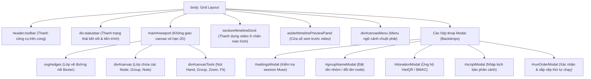

# Phân tích Chi tiết Tệp: `app.html`

## 1. Thông tin chung
- **Đường dẫn file:** `app.html`
- **Đường dẫn mã nguồn gốc:** [../../app.html](../../app.html)
- **Chức năng chính:** Khung nhìn giao diện người dùng Single Page Application của MuseFlow, chứa thanh công cụ Toolbar, thanh trạng thái Statusbar, vùng nhìn Canvas Viewport, dock Timeline, cửa sổ xem trước Timeline Preview và các Modal đối thoại.

---

## 2. Vai trò trong Hệ thống
- **Thuộc tầng:** Tầng Hiển thị / Trực quan (Presentation Layer).
- **Được gọi bởi:** Trình duyệt Chrome khi mở trang tiện ích thông qua [background.js](../../background.js).
- **Gọi đến:**
  - [styles.css](../../styles.css): Định dạng giao diện.
  - `vendor/ffmpeg/ffmpeg.js`: Động cơ xử lý video.
  - [app.js](../../app.js): Toàn bộ logic tương tác.

---

## 3. Cấu trúc Cây Phân cấp DOM chính

---

## 4. Các khu vực giao diện trọng yếu

1. **Thanh công cụ Toolbar (`.toolbar`):** Chứa nút thêm node (`＋ Add node`), nhập kịch bản (`＋ Script → Nodes`), lưu/tải file JSON (`Save workflow`, `Import workflow`), cài đặt session và nút chạy tổng (`▶ Run workflow`).
2. **Thanh trạng thái Statusbar (`.statusbar`):** Hiển thị đèn trạng thái kết nối Muse.ai (`#museStatus`), thông báo bản cập nhật mới (`#updateNotice`), và tiến trình thực thi (`#runStatus`).
3. **Vùng nhìn Canvas Viewport (`#viewport`):**
   - Lớp `#edges`: Thẻ SVG nhận diện tọa độ 0,0 để vẽ các đường nối có hướng.
   - Lớp `#canvas`: Chứa các phần tử DOM của các node chức năng.
4. **Dock Timeline (`#timelineDock`):** Thanh biên tập video ở chân màn hình với thước đo thời gian (`.timeline-ruler`), các clip (`.dock-clip`), và nút kích hoạt xuất video MP4/WebM (`#timelineExportBtn`).
5. **Cửa sổ Preview Kép (`#timelinePreviewPanel`):** Chứa 2 thẻ `<video>` (`#timelinePlayer` và `#timelinePlayerNext`) phục vụ kỹ thuật xem trước không gián đoạn (seamless double-buffering).

---

## 5. Bảng Phụ thuộc (Dependencies)
- **Thư viện bên ngoài:** `vendor/ffmpeg/ffmpeg.js` (FFmpeg WASM wrapper).
- **Module nội bộ tham chiếu:** [styles.css](../../styles.css), [app.js](../../app.js), [icons/26flow.svg](../../icons/26flow.svg).

---

## 6. Lưu ý Kỹ thuật và Đánh giá Rủi ro
- **Khả năng tương thích Responsive:** Sử dụng CSS Grid cho thẻ `body` kết hợp với Media Queries để thanh dock Timeline tự động co giãn và thu nhỏ trên màn hình có chiều cao hạn chế (`max-height: 640px`).
- **Khả năng tiếp cận (Accessibility - a11y):** Các nút bấm và modal đều có thuộc tính `role="dialog"`, `aria-modal="true"`, `aria-label` và phím tắt điều hướng `Escape` / `Enter`.

---

## Liên kết liên quan
- [Module Canvas Core](../03-module/canvas-core.md)
- [Module Timeline Engine](../03-module/timeline-engine.md)
- [Chi tiết styles.css](styles-css.md)
- [Chi tiết app.js](app-js.md)
