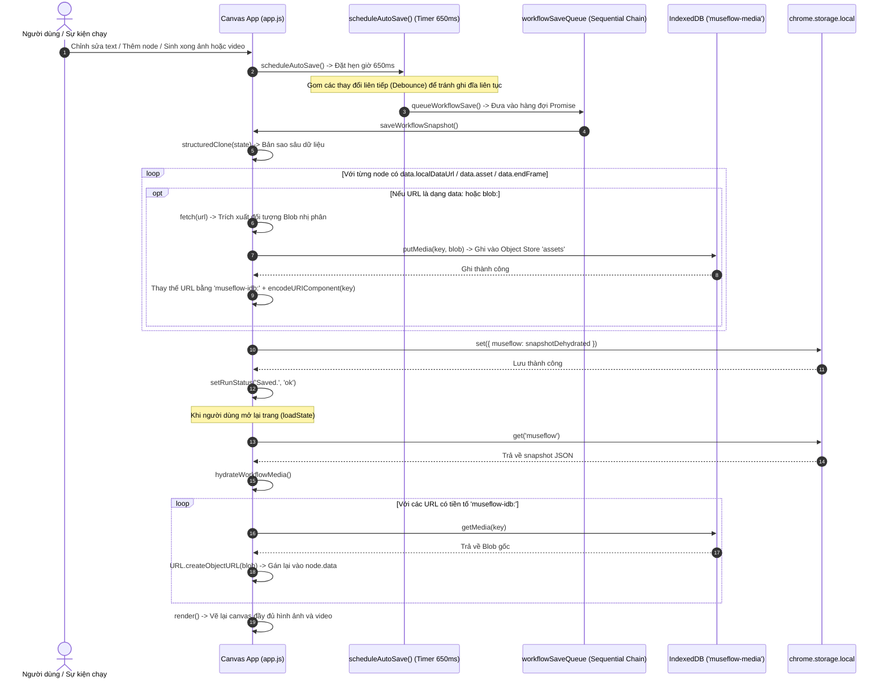

# Luồng Đồng bộ và Lưu trữ Lai (IndexedDB & Chrome Storage)

## 1. Mục đích
Mô tả chi tiết luồng xử lý tự động lưu (Auto-save), cơ chế **Dehydration** (tách dữ liệu nhị phân nặng đưa vào IndexedDB) và **Hydration** (tái lập Object URL khi nạp ứng dụng) nhằm đảm bảo dữ liệu workflow được bảo toàn bền vững mà không bị giới hạn bởi trần dung lượng 10MB của `chrome.storage.local`.

---

## 2. Sơ đồ Tuần tự (Sequence Diagram)

---

## 3. Các đặc điểm tối ưu hóa hiệu năng
1. **Debounce Auto-Save (650ms):** Khi người dùng gõ văn bản nhanh trong textarea hoặc di chuyển chuột kéo node liên tục, hàm `scheduleAutoSave()` sẽ reset bộ hẹn giờ để không thực hiện ghi đĩa liên tục, bảo vệ tuổi thọ ổ cứng và tránh làm chậm luồng UI.
2. **Hàng đợi Promise tuần tự (`workflowSaveQueue`):** Toàn bộ các yêu cầu lưu được xếp nối tiếp nhau (`workflowSaveQueue = workflowSaveQueue.catch(()=>{}).then(saveWorkflowSnapshot)`). Điều này ngăn chặn tình trạng một tác vụ lưu trước đó chưa ghi xong IndexedDB thì tác vụ lưu mới đã đè lên làm rách dữ liệu (race condition).
3. **Bộ nhớ đệm trong phiên (`cache Map`):** Trong quá trình nạp lại (`hydrateWorkflowMedia`), nếu cùng một ảnh được chia sẻ cho nhiều node (ví dụ node References nối sang 5 node Generate khác nhau), hàm hydrate chỉ đọc IndexedDB và gọi `URL.createObjectURL` đúng một lần duy nhất, chia sẻ chung URL blob cho các node để tiết kiệm tối đa bộ nhớ RAM.

---

## Liên kết liên quan
- [Module Lưu trữ](../03-module/storage-system.md)
- [Module Canvas Core](../03-module/canvas-core.md)
- [Chi tiết Luồng thực thi](thuc-thi-workflow-sinh-media.md)
