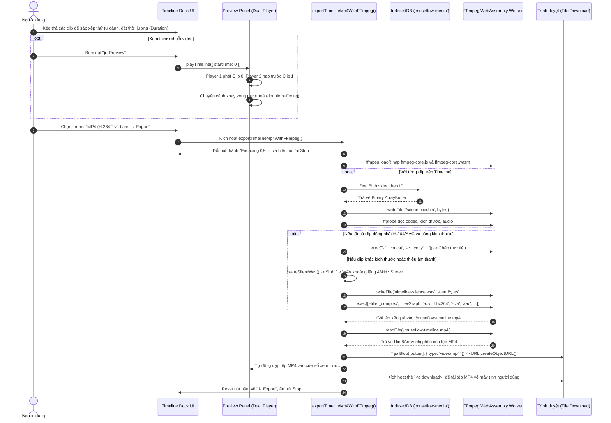

# Luồng Dựng và Xuất Video Timeline (FFmpeg WASM & WebM)

## 1. Mục đích
Mô tả quy trình xử lý biên tập các clip video trên thanh dock Timeline, từ thao tác sắp xếp thứ tự phân cảnh, xem trước chuỗi video bằng kỹ thuật xoay vòng 2 player, cho đến khi ghép và xuất thành tệp video MP4 (H.264/AAC) hoàn chỉnh bằng FFmpeg WebAssembly ngay trên trình duyệt.

---

## 2. Sơ đồ Tuần tự (Sequence Diagram)

---

## 3. Các đặc điểm kỹ thuật nổi bật
1. **Khả năng ghép không cần nén lại (Zero-loss Stream Copy):** Nếu người dùng xuất các video tải trực tiếp từ Muse.ai cùng định dạng 1080p và AAC, FFmpeg sẽ chạy ở chế độ `-c copy`. Thời gian ghép một video 1 phút chỉ mất từ **1 đến 3 giây**, giữ trọn vẹn chất lượng điểm ảnh gốc.
2. **Tự động bù trừ âm thanh (Audio Infill):** Nếu người dùng có một clip câm (silent clip) xen giữa các clip có tiếng, engine tự động chèn dải âm thanh khoảng lặng để đảm bảo luồng audio không bị ngắt hoặc mất đồng bộ tiếng-hình (A/V desync).
3. **Cơ chế Hủy khẩn cấp (Graceful Abort):** Người dùng có thể bấm nút **■ Stop** bất cứ lúc nào trong lúc xuất video; hàm `stopTimelineExport()` sẽ gửi tín hiệu hủy tới AbortController và gọi `ffmpeg.terminate()` để giải phóng ngay lập tức luồng Web Worker và bộ nhớ RAM.

---

## Liên kết liên quan
- [Module Timeline Engine](../03-module/timeline-engine.md)
- [Module Lưu trữ](../03-module/storage-system.md)
- [Chi tiết Luồng thực thi Workflow](thuc-thi-workflow-sinh-media.md)
