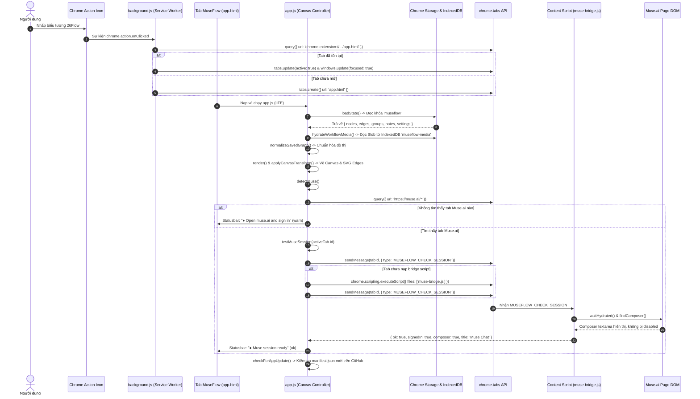

# Luồng Khởi chạy và Kết nối Phiên Muse.ai

## 1. Mục đích
Mô tả toàn bộ trình tự khởi chạy của tiện ích MuseFlow từ lúc người dùng bấm biểu tượng tiện ích trên thanh công cụ của Chrome, nạp trạng thái workflow đã lưu, cho đến khi tự động bắt tay (handshake) với tab Muse.ai đang mở để xác nhận phiên làm việc sẵn sàng.

---

## 2. Sơ đồ Tuần tự (Sequence Diagram)

---

## 3. Các bước xử lý chi tiết
1. **Kiểm tra Tab trùng lặp:** `background.js` truy vấn URL tiện ích để tránh việc người dùng nhấp nhiều lần mở ra nhiều tab canvas trùng lặp gây lãng phí tài nguyên RAM và xung đột bộ nhớ IndexedDB.
2. **Khôi phục trạng thái:** `loadState()` đọc dữ liệu đồ thị từ Chrome Storage, đồng thời gọi `hydrateWorkflowMedia()` để chuyển đổi các khóa lưu trữ `museflow-idb:...` thành `blob:` URLs hiển thị trên canvas.
3. **Tự động bắt tay (Auto-handshake):** `detectMuse()` tự động rà soát danh sách các tab đang mở tên miền `https://muse.ai/*`. Nếu tab đó vừa được mở hoặc người dùng vừa tải lại trang Muse, `chrome.tabs.onUpdated` và `chrome.tabs.onCreated` sẽ tự động kích hoạt kiểm tra lại phiên làm việc mà không cần người dùng bấm kiểm tra thủ công.
4. **Kiểm tra tính sẵn sàng:** `muse-bridge.js` kiểm tra xem phần tử `<textarea>` soạn thảo tin nhắn có hiển thị không, trang web đã hoàn tất hydration chưa, và có đang hiển thị form đăng nhập mật khẩu hay không.

---

## Liên kết liên quan
- [Kiến trúc tổng thể](../01-tong-quan/kien-truc.md)
- [Module Muse Bridge](../03-module/muse-bridge.md)
- [Đặc tả Message Protocol](../06-api/message-protocol.md)
