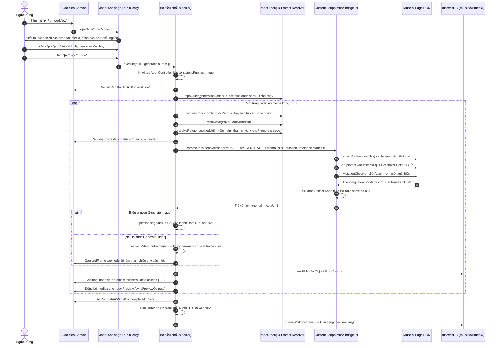

# Luồng Thực thi Workflow và Sinh Media

## 1. Mục đích
Mô tả quy trình xử lý từ khi người dùng kích hoạt lệnh chạy workflow (hoặc chạy một node đơn lẻ) cho đến khi toàn bộ các node tạo ảnh và video được thực thi tuần tự theo đúng thứ tự phụ thuộc topo, tải media về lưu vào IndexedDB và cập nhật lên Timeline.

---

## 2. Sơ đồ Tuần tự (Sequence Diagram)



---

## 3. Các điểm kiểm soát chất lượng (Quality Control Gates)
1. **Kiểm tra tiền đề trước khi chạy (`missingGenerationPrerequisites`):** Modal thứ tự chạy sẽ cảnh báo ngay nếu người dùng chọn chạy một node video đòi hỏi ảnh tham chiếu từ một node ảnh chưa từng được tạo kết quả trước đó.
2. **Khóa liên tục khung hình (Continuity Lock Prompting):** Nếu node video kế tiếp bật cờ `continuity: true`, hệ thống tự động bổ sung câu lệnh hướng dẫn chặt chẽ vào đầu prompt gửi cho Muse:
   ```text
   CONTINUITY LOCK: Attached image 1 is the exact final frame of the previous Timeline clip.
   Use image 1 as the exact first frame of this video: preserve its subject identity, pose, position, camera angle, crop, lighting, and background. Continue motion naturally from that precise moment.
   ```
3. **Kiểm tra sai lệch tỷ lệ khung hình (Aspect Ratio Mismatch):** Nếu người dùng yêu cầu tỷ lệ 16:9 nhưng Muse.ai trả về ảnh vuông 1:1, hệ thống sẽ phát hiện độ lệch tỷ lệ vượt ngưỡng log-score `> 0.09` và ném lỗi rõ ràng để người dùng điều chỉnh thiết lập trên composer của Muse.ai.

---

## Liên kết liên quan
- [Module Graph Engine](../03-module/graph-engine.md)
- [Module Muse Bridge](../03-module/muse-bridge.md)
- [Luồng Xử lý Từ chối và Thử lại](xu-ly-refusal-va-retry.md)
