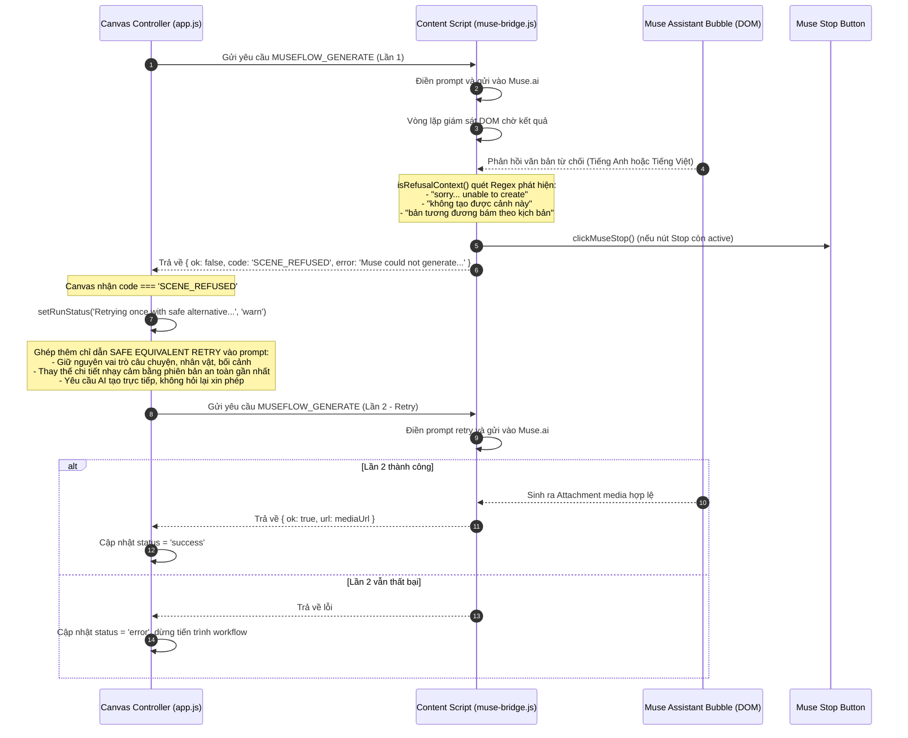

# Luồng Nhận diện Từ chối (SCENE_REFUSED) và Tự động Thử lại

## 1. Mục đích
Khi tạo video hoặc hình ảnh bằng mô hình AI trên Muse.ai, một số prompt có thể vô tình chạm phải các bộ lọc an toàn nội dung (Content Policy / Safety Guidelines) hoặc AI phản hồi từ chối bằng lời thoại thông thường (ví dụ: *"Tôi rất tiếc, tôi không thể tạo cảnh này theo yêu cầu..."*). Luồng này mô tả cách MuseFlow tự động phát hiện tình huống này và thực hiện thử lại một lần duy nhất với prompt thay thế an toàn gần nhất.

---

## 2. Sơ đồ Tuần tự (Sequence Diagram)



---

## 3. Quy tắc Prompting "Safe Equivalent Retry"
Nội dung chỉ dẫn được MuseFlow tự động ghép thêm vào cuối prompt khi phát hiện bị từ chối:

```text
[PROMPT GỐC CỦA CẢNH]

SAFE EQUIVALENT RETRY:
The previous version could not be generated. Create a close, allowed alternative for the same scene now.
Stay faithful to the script's story purpose, characters, relationship, setting, action, mood, visual style, framing, continuity, and requested duration/aspect ratio.
Change only the specific detail that prevents generation, replacing it with the nearest safe equivalent.
Keep this scene in the story; do not skip it or change what it needs to accomplish.
Do not ask a follow-up question or ask permission; generate the alternative in this attempt.
Follow all content and safety rules.
```

## 4. Các đặc tính an toàn của cơ chế
1. **Chỉ thử lại 1 lần duy nhất (Single Retry Gate):** Không tạo vòng lặp thử lại vô hạn để tránh làm cạn kiệt credit của tài khoản người dùng nếu cảnh đó thực sự vi phạm chính sách nghiêm trọng.
2. **Không làm gián đoạn kịch bản:** Giữ nguyên các kết nối, thứ tự cảnh trên Timeline và các tham số kỹ thuật (aspect ratio, duration).
3. **Phát hiện đa ngôn ngữ:** Nhận diện được cả phản hồi từ chối bằng tiếng Anh lẫn tiếng Việt thường gặp khi người dùng nhập kịch bản tiếng Việt.

---

## Liên kết liên quan
- [Module Muse Bridge](../03-module/muse-bridge.md)
- [Luồng Thực thi Workflow](thuc-thi-workflow-sinh-media.md)
- [Đặc tả Message Protocol](../06-api/message-protocol.md)
