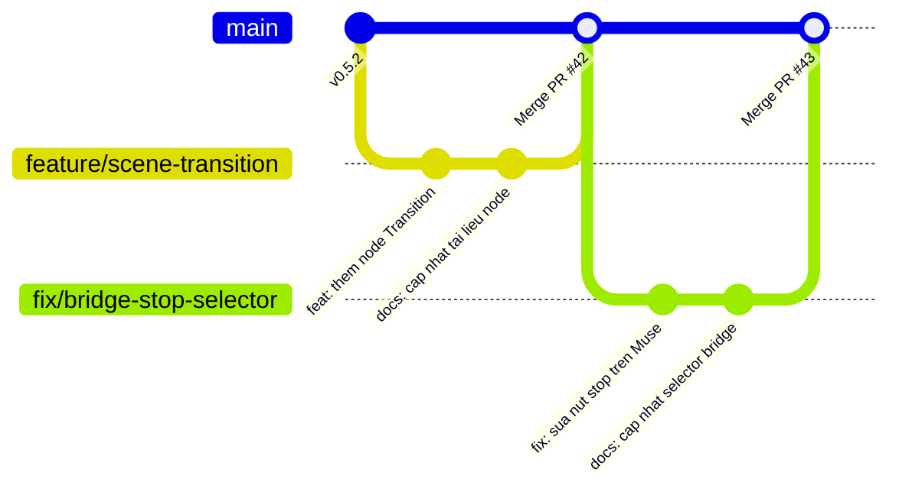

# Quy trình Đóng góp Mã nguồn (Contribution Workflow)

## 1. Nguyên tắc cốt lõi
1. **Tài liệu song hành cùng mã nguồn (Docs as Code):** Mọi thay đổi logic, thêm node mới, sửa selector bridge hay thêm phím tắt **bắt buộc phải cập nhật tài liệu tương ứng trong thư mục `docs/`**.
2. **Bảo toàn chuẩn zero-build:** Không đưa các công cụ build bắt buộc vào luồng phát triển chuẩn của dự án.
3. **Kiểm thử cú pháp trước khi mở PR:** Không tạo Pull Request nếu các lệnh kiểm tra cú pháp `node -c` chưa vượt qua.

---

## 2. Quy trình Git Flow từng bước



### Bước 1: Fork và Clone Repository
```bash
# Clone fork của bạn về máy
git clone https://github.com/<YOUR_USERNAME>/museflow.git
cd museflow

# Cấu hình remote upstream trỏ về kho gốc
git remote add upstream https://github.com/bynne2602/museflow.git
```

### Bước 2: Tạo nhánh làm việc (Branch)
Đặt tên nhánh theo chuẩn:
- `feat/<ten-tinh-nang>`: Tính năng mới (ví dụ: `feat/audio-waveform`, `feat/node-crop`).
- `fix/<ten-loi>`: Sửa lỗi (ví dụ: `fix/aspect-ratio-check`, `fix/muse-composer-selector`).
- `docs/<noi-dung>`: Bổ sung hoặc chỉnh sửa tài liệu.
- `refactor/<module>`: Tái cấu trúc mã nguồn mà không đổi hành vi.

```bash
git checkout -b feat/custom-resolution-node
```

### Bước 3: Phát triển và Viết tài liệu
1. Viết code trong các file tương ứng (`app.js`, `styles.css`, `app.html`...).
2. Bổ sung JSDoc tiếng Việt đầy đủ cho mọi hàm mới.
3. Mở tệp tài liệu liên quan trong `docs/` (ví dụ `docs/03-module/` hoặc `docs/04-chi-tiet-ma-nguon/`) và cập nhật mô tả tính năng.

### Bước 4: Kiểm tra cục bộ
```powershell
# 1. Kiểm tra cú pháp toàn bộ file JS
node -c background.js; node -c muse-bridge.js; node -c app.js

# 2. Tải lại extension trong Chrome (chrome://extensions) và test thực tế
```

### Bước 5: Commit theo chuẩn Conventional Commits
Quy cách viết commit message:
```text
<loai>(<pham-vi>): <mo-ta-ngan-gon-bang-tieng-viet-hoac-anh>

[Mo ta chi tiet neu co]

[Lien ket issue neu co]
```
Ví dụ:
- `feat(nodes): them tuy chon ti le khung hinh 4:5 cho node generateImage`
- `fix(bridge): cap nhat selector nut gui khi Muse doi DOM`
- `docs(timeline): bo sung so do dual buffering video player`

### Bước 6: Tạo Pull Request (PR)
1. Đẩy nhánh lên fork của bạn:
   ```bash
   git push origin feat/custom-resolution-node
   ```
2. Truy cập GitHub và bấm **Compare & pull request**.
3. Điền đầy đủ thông tin theo mẫu template PR (`.github/PULL_REQUEST_TEMPLATE.md`).
4. Tích chọn vào mục xác nhận:
   - [x] Đã chạy kiểm tra cú pháp `node -c` thành công.
   - [x] Đã cập nhật tài liệu kỹ thuật tương ứng trong thư mục `docs/`.
   - [x] Đã thử nghiệm thực tế với phiên Muse.ai.

---

## Liên kết liên quan
- [Quy ước lập trình](coding-convention.md)
- [Hướng dẫn kiểm thử](kiem-thu.md)
- [Báo cáo đề xuất cải tiến](../08-phu-luc/de-xuat-cai-tien.md)
