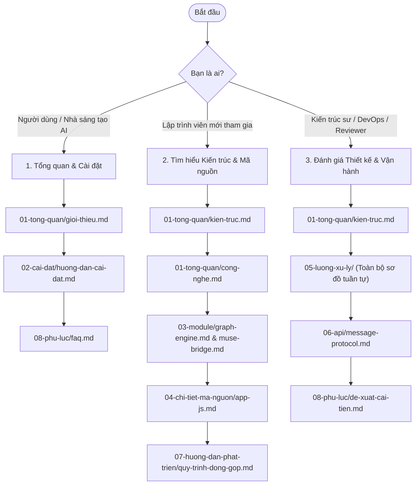

# Hệ thống Tài liệu Kỹ thuật MuseFlow (26Flow)

Chào mừng bạn đến với trung tâm tài liệu kỹ thuật toàn diện của dự án **MuseFlow (26Flow)**. Bộ tài liệu này được biên soạn theo chuẩn công nghiệp, cung cấp góc nhìn chuyên sâu từ tổng quan kiến trúc, thiết kế chi tiết từng module, phân tích mã nguồn đến quy chuẩn phát triển và kiểm thử.

---

## 🗺️ Hướng dẫn Lộ trình Đọc Tài liệu ("Đọc gì trước, đọc gì sau?")

Để tiếp cận dự án một cách hiệu quả và tiết kiệm thời gian nhất, bạn nên đọc tài liệu theo lộ trình phù hợp với vai trò của mình:

---

## 📚 Mục lục Chi tiết Toàn bộ Tài liệu

### 01. Tổng quan Dự án (`docs/01-tong-quan/`)
- [**Giới thiệu Dự án**](01-tong-quan/gioi-thieu.md): Mục tiêu, phạm vi ứng dụng và đối tượng người dùng.
- [**Kiến trúc Tổng thể**](01-tong-quan/kien-truc.md): Mô hình kiến trúc phân tầng, nguyên lý đồ thị DAG, sơ đồ luồng dữ liệu end-to-end.
- [**Cấu trúc Thư mục**](01-tong-quan/cau-truc-thu-muc.md): Cây thư mục đầy đủ kèm chú thích chức năng từng thư mục.
- [**Công nghệ & Runtime**](01-tong-quan/cong-nghe.md): Ngôn ngữ, chuẩn WebExtension Manifest V3, WebAssembly và triết lý zero-dependency.

### 02. Hướng dẫn Cài đặt & Vận hành (`docs/02-cai-dat/`)
- [**Yêu cầu Hệ thống**](02-cai-dat/yeu-cau-he-thong.md): Phiên bản trình duyệt, yêu cầu tài khoản Muse.ai và thông số phần cứng.
- [**Hướng dẫn Cài đặt**](02-cai-dat/huong-dan-cai-dat.md): Các bước cài đặt chế độ Developer Mode, nạp unpacked extension.
- [**Cấu hình & Quyền hạn**](02-cai-dat/cau-hinh.md): Ma trận quyền hạn của `manifest.json`, chính sách bảo mật CSP và lưu trữ.
- [**Khởi chạy & Vận hành**](02-cai-dat/chay-du-an.md): Lệnh kiểm thử cú pháp, debug DevTools và sinh tài liệu JSDoc động.

### 03. Phân tích Các Phân hệ Module (`docs/03-module/`)
- [**Module Canvas Core**](03-module/canvas-core.md): Không gian 2D, chuyển đổi ma trận tọa độ, pan/zoom, marquee selection, groups và notes.
- [**Module Graph Engine**](03-module/graph-engine.md): Định nghĩa node/port, thuật toán Kahn sắp xếp Topo, thuật toán BFS phát hiện chu trình, dây nối Bezier SVG.
- [**Module Script Parser**](03-module/script-parser.md): Bộ bóc tách kịch bản phân cảnh tiếng Việt/Anh, cơ chế bung khóa `[CHAR_LOCK]` và tự động sinh node.
- [**Module Muse Bridge**](03-module/muse-bridge.md): Cầu nối tự động hóa DOM trên trang Muse.ai, React synthetic setter, DataTransfer upload và MutationObserver.
- [**Module Timeline Engine**](03-module/timeline-engine.md): Thanh dock timeline, kỹ thuật xem trước kép seamless double-buffering và ghép MP4 bằng FFmpeg WASM.
- [**Module Storage System**](03-module/storage-system.md): Kiến trúc lưu trữ lai Hybrid Storage, cơ chế Dehydration và Hydration giữa Chrome Storage và IndexedDB.

### 04. Phân tích Chi tiết Từng Tệp Mã nguồn (`docs/04-chi-tiet-ma-nguon/`)
- [**manifest.json**](04-chi-tiet-ma-nguon/manifest-json.md): Cấu hình quyền và Content Security Policy.
- [**background.js**](04-chi-tiet-ma-nguon/background-js.md): Service Worker xử lý điểm vào kích hoạt tiện ích.
- [**muse-bridge.js**](04-chi-tiet-ma-nguon/muse-bridge-js.md): Content script tự động hóa DOM trên trang Muse.ai.
- [**app.html**](04-chi-tiet-ma-nguon/app-html.md): Cấu trúc DOM giao diện Single Page Canvas.
- [**app.js**](04-chi-tiet-ma-nguon/app-js.md): Toàn bộ logic lõi điều khiển toàn cục (~1.350 dòng).
- [**styles.css**](04-chi-tiet-ma-nguon/styles-css.md): Hệ thống thiết kế Tokens, Dark Theme và Responsive Canvas.
- [**museflow-scene-script-template-vi.txt**](04-chi-tiet-ma-nguon/scene-script-template.md): Mẫu kịch bản phân cảnh chuẩn hóa bằng tiếng Việt.

### 05. Sơ đồ Tuần tự Luồng Xử lý (`docs/05-luong-xu-ly/`)
- [**Khởi chạy & Kết nối Phiên Muse**](05-luong-xu-ly/khoi-chay-va-ket-noi-muse.md): Luồng handshake tự động giữa Canvas App và tab Muse.ai.
- [**Thực thi Workflow & Sinh Media**](05-luong-xu-ly/thuc-thi-workflow-sinh-media.md): Luồng chạy toàn bộ quy trình từ sắp xếp topo đến nhận ảnh/video.
- [**Xử lý Từ chối & Tự động Thử lại**](05-luong-xu-ly/xu-ly-refusal-va-retry.md): Luồng nhận diện `SCENE_REFUSED` và gửi prompt thay thế an toàn.
- [**Dựng & Xuất Video Timeline**](05-luong-xu-ly/dung-va-xuat-video-timeline.md): Luồng xem trước dual-player và xuất tệp MP4 qua FFmpeg WebAssembly.
- [**Đồng bộ & Lưu trữ IndexedDB**](05-luong-xu-ly/dong-bo-va-luu-tru-indexeddb.md): Luồng Dehydration và Hydration tệp media nhị phân.

### 06. Đặc tả Giao thức Tin nhắn Nội bộ (`docs/06-api/`)
- [**Internal Message Passing Protocol**](06-api/message-protocol.md): Đặc tả chi tiết các thông điệp `MUSEFLOW_CHECK_SESSION`, `MUSEFLOW_GENERATE`, `MUSEFLOW_STOP_GENERATION` và danh mục mã lỗi chuẩn.
  *(Ghi chú kiến trúc: Dự án chạy theo mô hình Client-side Browser Extension, không sử dụng REST API ngoài mà dùng Chrome Runtime Messaging API).*

### 07. Hướng dẫn Phát triển & Đóng góp (`docs/07-huong-dan-phat-trien/`)
- [**Quy ước Lập trình**](07-huong-dan-phat-trien/coding-convention.md): Quy chuẩn đặt tên, chuẩn JSDoc tiếng Việt, thụt lề và xử lý bất đồng bộ.
- [**Quy trình Đóng góp Mã nguồn**](07-huong-dan-phat-trien/quy-trinh-dong-gop.md): Git flow, cách đặt tên nhánh, quy tắc commit và tạo Pull Request.
- [**Hướng dẫn Kiểm thử**](07-huong-dan-phat-trien/kiem-thu.md): Kiểm tra cú pháp Node.js, Unit test thuật toán đồ thị với `node:test`, kịch bản test thủ công.

### 08. Phụ lục (`docs/08-phu-luc/`)
- [**Bảng Chú giải Thuật ngữ**](08-phu-luc/thuat-ngu.md): Giải nghĩa các khái niệm kỹ thuật cốt lõi (DAG, Topo sort, In-degree, Dehydration, Dual buffering...).
- [**Câu hỏi Thường gặp (FAQ)**](08-phu-luc/faq.md): Tổng hợp các câu hỏi phổ biến và cách xử lý lỗi khi sử dụng.
- [**Đề xuất Cải tiến Kiến trúc**](08-phu-luc/de-xuat-cai-tien.md): Báo cáo nợ kỹ thuật (Technical Debt) và lộ trình nâng cấp kiến trúc ES Modules.
